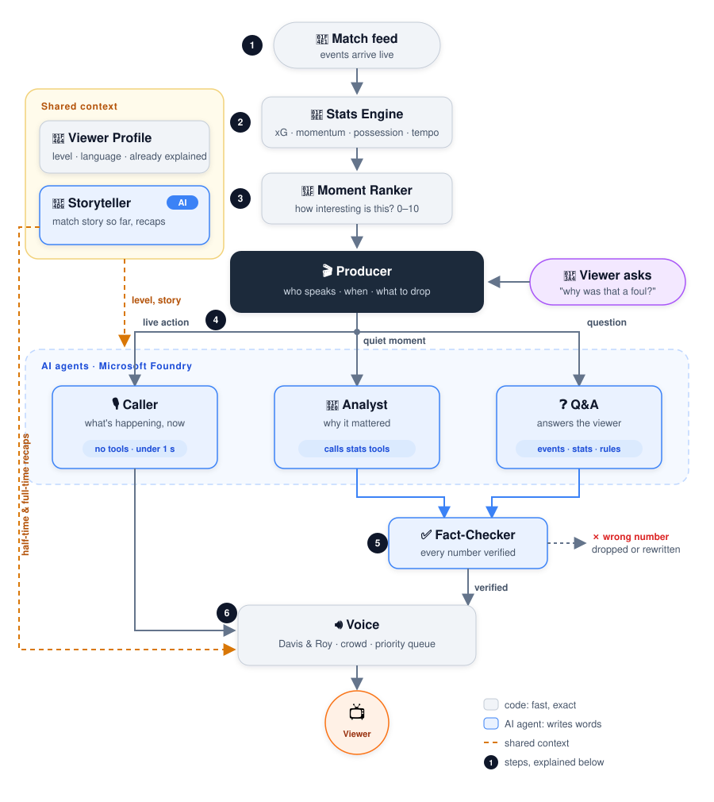

# Match Intelligence

**Live AI football commentary that adapts to you.** Two AI commentators call and explain a match at your level, from someone watching their first game to a seasoned analyst, and every number they say is computed from the match data, not guessed. Ask "why was that a foul?" by voice or text mid-match and get an answer without the match ever pausing.

Built for the Microsoft × Premier League [Inside the Game](https://github.com/microsoft/insidethegamehackathon) hackathon.

**Live demo:** https://match-intelligence-live.purplesand-eefdeaf2.francecentral.azurecontainerapps.io

## Try it in a minute

1. Open the live demo, turn the sound on and press **Kick off**. You're watching a full, fictional 90-minute match (a comeback) with a crowd, a caller and an analyst.
2. Switch the level (**Beginner / Fan / Analyst**) at any time: the next line follows it.
3. Ask a question: type it, press the mic, or tap a suggestion. The match keeps going while Sonia answers. Questions stay open after full time too.
4. To jump to the drama, add `?start=85` to the link (the winner comes at 88'). Other matches: `?source=synthetic:red_card`, `?source=synthetic:late_equaliser`.

## What it does

- **Two voices with different jobs.** **Guy** is the play-by-play caller: short, live, louder as moments get bigger. **Sonia** is the analyst: in the quiet moments she explains *why* a moment mattered.
- **Adapts to the viewer.** The same goal gets plain words and at most one simple number for a beginner, and xG, possession and the run of play for an analyst.
- **Explainable by design.** Numbers (xG, possession, momentum, pass value) come from a stats engine written in code. The agents ask for them through tools and put them into words; they never compute or invent a statistic.
- **Questions mid-match.** Voice or text, answered in the analyst's voice in a few seconds. "That" and "just now" are resolved from the moment the question was asked.
- **It reads the game, not just the events.** Tactical detectors in code find patterns as they build (the side a team keeps attacking down, high pressing, quick counters, crossing, territory) and only claim one when there's enough of it. When a goal comes down a team's usual side, Sonia connects them: "25 of their 31 final-third entries this match came down the right".
- **It remembers the match.** A match log in code (goals, red cards, big chances, each pattern as it appears, and what was said on air) feeds a Storyteller agent that keeps the story so far. When a goal pays off something Sonia said earlier, she says so with the real minute ("We flagged that right side at 66'"). She reads recaps at half-time and full time, and "What did I miss?" catches up a viewer who just joined.
- **A whole league, not one match.** The Meridian League: 20 fictional clubs with their own squads, captains, colours and styles of play, a full fixture list, and ten matchdays already played. Pick any of today's ten fixtures; the result goes into the table at full time. Ask "where are they in the table?" or "who's their top scorer?" and the answer comes from the league's results.
- **A broadcast, not a chatbot.** A ranker scores every event 0–10 so the commentators know when to speak and when to stay quiet, a goal cuts in over whatever is playing, and the crowd roars before the caller does.

## How it works

<p align="center"></p>

1. **Match feed.** Events (passes, shots, fouls...) arrive one at a time, as from a live data provider, in a StatsBomb-style schema ([docs/event-schema.md](docs/event-schema.md)). For the demo the feed replays matches from our own synthetic generator.
2. **Stats engine (code).** Score, xG, possession, momentum, tempo, pass progression, and tactical patterns from event locations and timing: always exact, and exposed to the agents as tools.
3. **Moment ranker (code).** Scores each event with a reason ("late go-ahead goal, against the run of play"), so most of the match is rightly left alone.
4. **Producer (code).** Decides who speaks and when: Guy on live moments, Sonia in the quiet after, the Q&A agent when a viewer asks. Every model call has a deadline and a fallback, so the broadcast never waits.
5. **AI agents** on Microsoft Foundry (`gpt-4.1-mini`) with the Microsoft Agent Framework: the **Storyteller** (the match story and recaps, in the background), the **Caller**, the **Analyst** (code hands it the facts for the moment, grouped by team) and **Q&A** (tools for match events, rules, tactics and the match picture). Both are checked before they speak.
6. **Voice.** Azure AI Speech turns each line into speech (Guy with built-in excited and shouting styles, Sonia calm), mixed over the crowd in the browser.

Design notes: [docs/agents.md](docs/agents.md), [docs/architecture.md](docs/architecture.md), and the lessons we learned building the agents in [AGENTS.md](AGENTS.md).

## Keeping the AI honest

- Every number comes from the stats engine, through tools or facts code hands the agent; tests check them.
- Every analyst line and every answer is checked in code before it's spoken: no number the agent wasn't given (answers are checked against what their tools returned for that question), possession, shots and xG with the right team, "more shots" or "more of the ball" right for the whole match and the last 10 minutes, the right chance label, the right scorer, no guessing. One retry, told exactly what was wrong; then silence for the analyst, or an honest "ask me again" for a viewer's question.
- Code decides the angle, the excitement and who speaks; the model writes the words. When the data disagrees with a story, code picks the angle that is true.
- The agents know they can't see the video: they never judge a referee's decision or whether a player was unlucky, and answer "was it deserved?" with data.
- Each agent was built step by step and checked by running it on real outputs at every level; the experiments are in [spikes/agents/](spikes/agents/).

## Built with

| Microsoft service | Used for |
|---|---|
| Microsoft Foundry (`gpt-4.1-mini`) | The Caller, Analyst and Q&A agents |
| Microsoft Agent Framework | Agents, tools as Python functions, structured output |
| Azure AI Speech | The two commentator voices (TTS) and the viewer's microphone (STT, short-lived tokens) |
| Azure Container Apps + Container Registry | Hosting the app, with managed identity (no keys in the app) |

Also: Python, FastAPI, React, TypeScript, Vite, the Web Audio API.

## Run locally

Needs Python 3.11+, Node 22+, the Azure CLI, and a `.env` at the repo root with the Azure settings (names in [.env.example](.env.example)). Without Azure, set `USE_AGENTS=false` and `USE_SPEECH=false` for template commentary in text.

```bash
az login                      # the agents use Entra ID, not a key
cd backend
python3 -m venv .venv
.venv/bin/pip install -r requirements-dev.txt
.venv/bin/uvicorn app.main:app --reload --port 8000
```

In a second terminal:

```bash
cd frontend
npm install
npm run dev
```

Open http://localhost:5173 and press **Kick off**. URL options: `?source=synthetic:<name>&speed=20&start=80&level=analyst`.

## Tests

```bash
cd backend && .venv/bin/ruff check . && .venv/bin/pytest          # no Azure needed
cd frontend && npm run lint && npm run build
cd backend && .venv/bin/python -m scripts.stress_test             # 3 full matches at once, real agents
```

The tests cover the stats, the ranker, every agent's logic with a fake model, the synthetic generator, and what happens when something fails mid-match (Speech down, the model slow or failing, junk from the browser, a viewer leaving). CI runs them on every pull request.

## Synthetic matches

All match data in the demo is **synthetic**, with fictional teams and players: [`backend/app/synthetic/`](backend/app/synthetic/) is a possession-chain simulator tuned with general football knowledge (about 25 shots, 2.5 goals and 22 fouls a match). Scenarios script the big moments of a story and the simulation plays the rest. See [DATA_POLICY.md](DATA_POLICY.md).

```bash
cd backend && .venv/bin/python -m scripts.generate_match comeback --seed 7
```

## Repo layout

| Path | What |
|---|---|
| `backend/app/agents/` | The Caller, Analyst and Q&A agents and the producer pipeline |
| `backend/app/stats/` | Stats engine, moment ranker, xG |
| `backend/app/synthetic/` | Synthetic match generator |
| `backend/app/league/` | The Meridian League: clubs, fixtures, season, results database |
| `backend/app/speech/` | Azure AI Speech |
| `frontend/` | React + TypeScript broadcast UI |
| `data/synthetic/` | Generated matches |
| `docs/` | Design and schema docs |
| `spikes/` | How each agent was built, step by step |
| `scripts/deploy.sh` | Deploy to Azure Container Apps ([docs/deploy.md](docs/deploy.md)) |

## Credits

- Crowd sound: "Free Crowd Cheering Sounds" by Gregor Quendel, [CC BY 4.0](https://creativecommons.org/licenses/by/4.0/). See [assets/audio/CREDITS.md](assets/audio/CREDITS.md).
- Teams, players and matches are fictional. Not affiliated with or endorsed by the Premier League or any club.

Team: Maayan Dotan and Dean Bazak.
