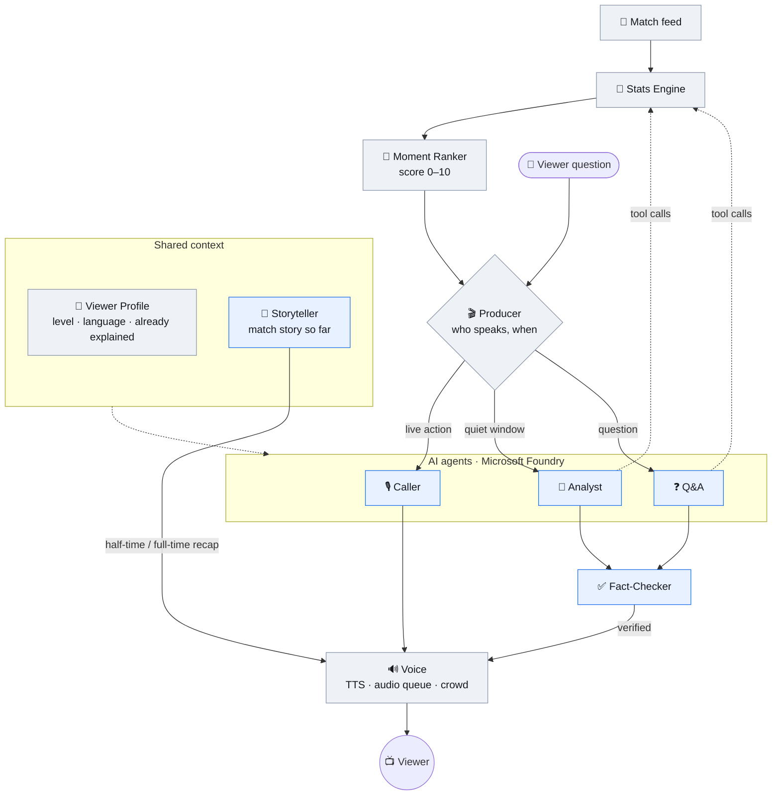

# Agent design

How the commentary system is put together: which parts are AI agents, which are plain code, how they talk to each other, and the order to build them in.

## The short version

**5 AI agents + 5 code components.**

| | Name | What it does | Code or AI | Issue |
|---|---|---|---|---|
| 🧮 | **Stats Engine** | Computes every number (xG, momentum, possession...) and exposes them as tools | Code | #10 |
| 🎯 | **Moment Ranker** | Scores each event 0–10: how interesting is this? | Code | #12 |
| 🎬 | **Producer** | Decides who speaks, when, and what to drop. Owns the timing | Code | #16 |
| 👤 | **Viewer Profile** | Level, language, what's already been explained | Code | #15 |
| 🔊 | **Voice** | Text to speech, audio queue, crowd | Code + Azure Speech | #19, #20 |
| 🎙️ | **Caller** | Short live calls as the action happens | AI | #13 |
| 🧠 | **Analyst** | The "why", backed by numbers from tools | AI | #14 |
| ✅ | **Fact-Checker** | Checks every number the Analyst or Q&A says | AI (code first) | #17 |
| ❓ | **Q&A** | Answers the viewer's questions mid-match | AI | #18 |
| 📖 | **Storyteller** | Keeps the match story so far; writes half-time and full-time recaps | AI | new |

**Rule of thumb:** anything that must be fast, exact or predictable is code. AI writes words and decides what's worth saying.

## The graph

**Grey = code, blue = AI.** Solid arrows are the main flow; dotted arrows are tool calls and shared context. Lines the Fact-Checker rejects are dropped or sent back for a rewrite.

## Who talks when

The Producer is a priority queue with rules, not an AI. Every line it gets has a priority and an expiry:

| What | Priority | Expires after | Who speaks |
|---|---|---|---|
| Goal, red card, penalty | 🔴 urgent | never | Caller (crescendo), then Analyst |
| Viewer question | 🔵 high | — | Q&A (analyst's voice) |
| Big chance, important foul | 🟠 high | 10 s | Caller |
| Analyst insight | 🟡 medium | 20 s | Analyst |
| Background stat | ⚪ low | 30 s | Analyst |
| Half-time / full-time recap | 🟣 at the break | — | Storyteller (both voices) |

- **Urgent** cuts whatever is playing and clears lower-priority lines.
- **The Analyst only speaks in quiet windows:** a stoppage (foul, out of play, substitution), or a few seconds after a goal once the Caller is done.
- **Expired lines are dropped**, never played late.
- **The match never pauses** for a question. Only urgent events interrupt an answer.

## Example: one goal, start to finish

1. Feed: `Pass` (through ball) → `Carry` → `Shot` (Goal)
2. Ranker: pass 4 ("line-breaking"), carry 6 ("into the box"), shot 10 ("goal against the run of play")
3. Producer: pass and carry go to the **Caller** as the build-up (excitement 1). The goal is **urgent**: Caller at excitement 2, crowd roar
4. Caller: "Arlo, through ball, Ferro is in behind..." → "GOAL! Northbridge lead!"
5. Producer: the restart is a quiet window, so it asks the **Analyst** about the goal
6. Analyst calls tools: `momentum()` → Westvale on top, `shot_quality(shot)` → xG 0.09, `pass_rarity(pass)` → top 4%
7. Analyst (fan level): "That came against the run of play. Westvale had 68% of the ball, and the shot was only a 9% chance."
8. **Fact-Checker**: 68% ✓ (possession tool), 9% ✓ (xG tool) → to Voice
9. Voice: Sonia reads it, crowd still buzzing underneath

## Agent contracts

Every AI agent gets the **viewer profile** (level, language, already-explained concepts) and returns structured JSON, never free text.

### 🎙️ Caller
- **Trigger:** Producer, on live events with score ≥ 3
- **Input:** the event, score, clock, last 3 events, viewer profile
- **Tools:** none (speed matters; everything it needs is in the input)
- **Output:** `{"speaker": "caller", "excitement": 0|1|2, "text": "..."}`, 1 short sentence
- **Rules:** describe, don't explain; build big moments as a crescendo of short lines
- **Latency budget:** ≤ 1 s for the model (it has to keep up with play)

### 🧠 Analyst
- **Trigger:** Producer, in a quiet window, with "what to talk about" (the last big moment, or a trend the ranker flagged)
- **Input:** topic event(s), match story so far, viewer profile
- **Tools:** `get_score`, `get_possession(recent)`, `get_momentum`, `get_tempo`, `get_shot_quality(event_id)`, `get_pass_rarity(event_id)`, `get_recent_events(n)`, later `explain_shot(event_id)` (SHAP, #11)
- **Output:** `{"speaker": "analyst", "excitement": 0, "text": "...", "claims": [{"value": "68%", "tool": "get_possession"}]}`, 1–3 sentences
- **Rules:** every number comes from a tool call; depth and vocabulary follow the viewer level
- **Latency budget:** 2–4 s (it speaks in pauses)

### ✅ Fact-Checker
- **Trigger:** every Analyst and Q&A line
- **How:** **code first.** Compare each `claims` entry with the tool results the agent actually got. Only if a number in the text isn't in `claims` does it call a small model to judge
- **Output:** `pass`, or `fail` with the reason (logged, and shown in the demo: "0 made-up numbers")
- **Latency budget:** ~0 s for the code path

### ❓ Q&A
- **Trigger:** the viewer asks (voice or text)
- **Input:** question, **the match time when it was asked**, viewer profile, match story
- **Tools:** `get_events_before(time, n)` (to resolve "that foul"), the stats tools, `get_rule(topic)` (a small rules glossary: offside, fouls, cards, VAR...)
- **Output:** 2–3 sentences at the viewer's level, spoken in the Analyst's voice
- **Latency budget:** 2–3 s

### 📖 Storyteller
- **Trigger:** every ~5 match minutes, and at half-time / full-time
- **Input:** stats snapshot, key moments since the last update, the previous story
- **Output:** the **match story so far** (a short paragraph the Analyst and Q&A use as memory), and **recaps** at the breaks, personalized by level
- **Why:** covers the brief's "narratives and recaps", and keeps the Analyst from repeating itself

## How it runs

- **The Producer and the pipeline are Python code in the backend** (`backend/app/agents/`), running on asyncio. Real-time priorities and interruptions don't belong inside an LLM.
- **The 5 AI agents run on Microsoft Foundry** with `gpt-4.1-mini`. Each has its own instructions and tools; the stats tools are Python functions. Whether they're defined with Foundry Agent Service or Microsoft Agent Framework is decided in #2.
- **Agents never call each other directly.** They go through the Producer, which keeps timing and priorities in one place. That's easier to debug and to show the judges.

## Build order

Each step ends with something that works and can be shown.

| Step | Build | Result | Issues |
|---|---|---|---|
| **1** | Moment Ranker + **Caller** + Producer v0 ("call everything scored ≥ 3") | Live play-by-play text | #12, #13 |
| **2** | **Analyst** with stats tools + Producer quiet windows + viewer level | Caller and analyst in dialogue, adapted to the level | #14, #16, #15 |
| **3** | **Fact-Checker** + Voice | Two voices, verified numbers | #17, #19, #20 |
| **4** | **Q&A** + push-to-talk | Viewer questions mid-match | #18, #21 |
| **5** | **Storyteller** + recaps | Half-time and full-time recaps, better memory | new |

Steps 1–2 are the basic tier; with them alone we have a submission. Steps 3–4 make it strong; 5 is the polish.

**Parallel work:** the Caller (step 1) only needs the Ranker, so it can start right after #2 picks the framework. The Analyst needs the stats tools from #10, which are ready in #28.

## Open decisions

- [ ] Agent framework: Foundry Agent Service or Microsoft Agent Framework (#2)
- [ ] Caller with or without a model call for routine events: a template ("Arlo to Ferro") is instant and free; the model is livelier
- [ ] Storyteller: new issue, or part of the Analyst?
